<a id="top"></a>

<div align="center">

# 🔭 DobsonGo

*A homemade GoTo and tracking system for my truss-tube Dobsonian telescope, driven from an Android phone.*


</div>

<p align="center">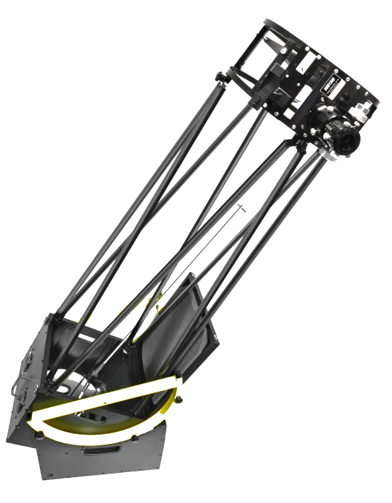</p>

DobsonGo turns a manual telescope into one that finds objects in the night sky by itself and keeps them in view, from stars and galaxies to, one day, fast-moving satellites. This page tells the story behind it: what makes observing the sky hard, why I decided to build this system myself rather than buy one, and how I am building it.

## 🌟 Highlights

- Turns a manual Dobsonian telescope into a **GoTo** telescope: select an object on the phone, and the motors point the telescope at it.
- **Tracks** the object as the Earth rotates, so it stays in the field of view.
- Reads the real position of both axes with **18-bit magnetic encoders**, instead of relying on motor step counting.
- **Wireless control** from an Android app over **Bluetooth Low Energy**.
- Long-term goal: tracking fast-moving satellites such as the **ISS**.

## 📑 Contents

**[📚 Part 1: Telescope theory](#part-1)**<br>
&emsp;1.1&ensp;[Two ways of looking at the sky](#11-two-ways-of-looking-at-the-sky)<br>
&emsp;1.2&ensp;[The telescope and the mount: two different things](#12-the-telescope-and-the-mount-two-different-things)<br>
&emsp;1.3&ensp;[Lenses or mirrors?](#13-lenses-or-mirrors)<br>
&emsp;1.4&ensp;[Equatorial or Dobsonian?](#14-equatorial-or-dobsonian)<br>
&emsp;1.5&ensp;[What "GoTo" means](#15-what-goto-means)<br>
&emsp;1.6&ensp;[Without GoTo: the art of star hopping](#16-without-goto-the-art-of-star-hopping)<br>
&emsp;1.7&ensp;[My telescope, and why I built DobsonGo](#17-my-telescope-and-why-i-built-dobsongo)

**[🛠️ Part 2: The DobsonGo project](#part-2)**<br>
&emsp;2.1&ensp;[The hardware](#21-the-hardware)<br>
&emsp;2.2&ensp;[The software](#22-the-software)<br>
&emsp;2.3&ensp;[Securing the connection](#23-securing-the-connection)<br>
&emsp;2.4&ensp;[Reading data from the app](#24-reading-data-from-the-app)<br>
&emsp;2.5&ensp;[The floating control menu](#25-the-floating-control-menu)

**[🌌 Part 3: Computing the position of celestial objects](#part-3)**<br>
&emsp;3.1&ensp;[Celestial coordinates](#31-celestial-coordinates)<br>
&emsp;3.2&ensp;[Orekit on Android](#32-orekit-on-android)<br>
&emsp;&emsp;3.2.1&ensp;[Adding the library](#321-adding-the-library)<br>
&emsp;&emsp;3.2.2&ensp;[Embedding the data](#322-embedding-the-data)<br>
&emsp;&emsp;3.2.3&ensp;[Using Orekit](#323-using-orekit)<br>
&emsp;3.3&ensp;[Three types of objects](#33-three-types-of-objects)<br>
&emsp;&emsp;3.3.1&ensp;[Static objects](#331-static-objects)<br>
&emsp;&emsp;3.3.2&ensp;[Artificial satellites](#332-artificial-satellites)<br>
&emsp;&emsp;3.3.3&ensp;[Orbital objects](#333-orbital-objects)<br>
&emsp;3.4&ensp;[JPL Horizons](#34-jpl-horizons)<br>
&emsp;&emsp;3.4.1&ensp;[Requesting the elements](#341-requesting-the-elements)<br>
&emsp;&emsp;3.4.2&ensp;[Reading the response](#342-reading-the-response)

---

<a id="part-1"></a>

## 📚 Part 1: Telescope theory

> *This part does not cover the code or the project. It explains the background for readers who want to understand why the project exists and how it works.*

### 1.1 Two ways of looking at the sky

Point a telescope at the Andromeda Galaxy, our nearest large neighbour, and you will not see the swirl of blue and gold from the posters. You will see a soft grey glow.

That is not a flaw of the telescope. It comes from the human eye. Our retina has two kinds of light-sensitive cells: **cones**, which see colour but need plenty of light, and **rods**, which are far more sensitive but cannot tell colours apart. The light from a distant galaxy or nebula is far too faint to wake up the cones, so only the rods respond, and the brain receives a black-and-white image. Only the brightest targets carry enough light to show their colours: the ochre of Mars, the cream and brown bands of Jupiter, the orange of a red giant star.

This is why amateur astronomy has a fundamental divide between **visual observation** and **astrophotography**.

A camera does not have this limit. Given enough time, its sensor keeps collecting light and records colour. In a true-colour photo, those colours come from the light the object really emits: the deep red of glowing hydrogen, the blue of young, hot stars. This is a big part of why astrophotography is so popular. But it comes at a price. A good image of a faint galaxy needs **hours of exposure**, split into many photos taken one after the other at regular intervals, then stacked together by software. And for every one of those photos, the telescope must **track** its target perfectly while the sky slowly turns overhead.

Visual observers accept the grey in exchange for something no photo can give: seeing, live and with your own eye, light that left a galaxy millions of years ago. That is the kind of astronomy I practise, and the kind DobsonGo is built for.

### 1.2 The telescope and the mount: two different things

In everyday language, "telescope" means the whole instrument. Astronomers split it in two:

- **The telescope** itself, or *optical tube*: the optics that collect the light and form an image.
- **The mount**: the support that holds the optics and lets you point them at the sky.

The two are chosen largely separately, and as the rest of this story shows, the choice of mount matters as much as the choice of optics.

### 1.3 Lenses or mirrors?

There are many families of telescopes. The two classic ones are refractors and Newtonian reflectors.

- A **refractor** uses a large lens at the front of the tube to bend the incoming light and bring it to a focus at the back, where the eyepiece sits.
- A **Newtonian reflector**, invented by Isaac Newton in 1668, uses mirrors instead. Light travels down an open tube to a **concave primary mirror** at the bottom, which reflects it back up and concentrates it. Just before it reaches the focus, a small **flat secondary mirror**, tilted at 45°, sends it out through the side of the tube into the eyepiece.

<p align="center">
  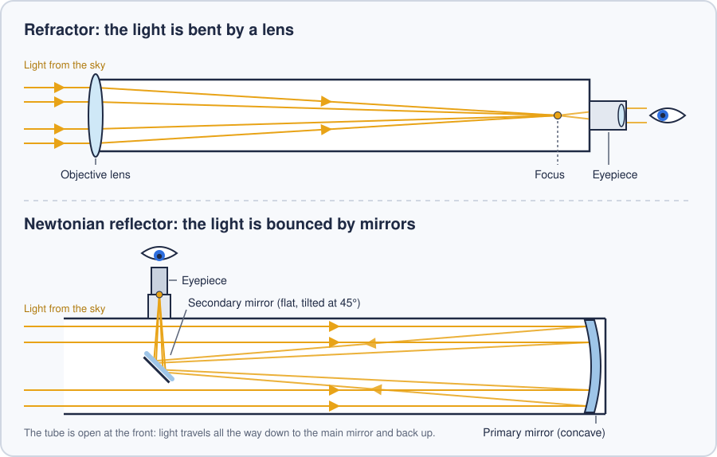
  <br>
  <sub><b>Figure 1.</b> How light travels through a refractor and through a Newtonian reflector.</sub>
</p>

#### Why the big ones are mirrors

Small refractors (lens) give beautiful, sharp images. But they become very expensive as they grow:

- Light passes *through* a lens, so the glass must be flawless through its whole thickness, not just on its surface.
- A single lens splits white light into its colours (chromatic aberration). Correcting this takes two or three lenses, so four to six surfaces to shape and polish.
- A lens can only be held by its edge, so a large one sags under its own weight.

A mirror avoids all three problems: the light never enters the glass, only one surface needs polishing, and the mirror can be supported from behind across its whole back.

History settled the question. The great refractor of Yerkes Observatory, completed in 1897 with a lens 102 cm across, marked the practical limit of lens telescopes; every giant telescope since then has used mirrors. Among amateurs, the Newtonian is the simplest and cheapest way to put a big mirror under the sky, which is why large amateur telescopes are almost always Newtonians. (Professional observatories use other mirror designs, such as the Cassegrain.)

#### Why aperture is everything

The most important number of Newtonian telescopes is the **diameter of its main mirror**, called its *aperture*. It controls two things:

- **How much light it collects.** This depends on the *area* of the mirror, so it grows with the *square* of its diameter: double the diameter and you collect **four** times as much light. Objects that were invisible become visible.
- **How much detail it can show.** A larger mirror separates finer details, so you can magnify the image more before it turns blurry. A common rule of thumb puts the maximum useful magnification at about twice the aperture in millimetres.

| Aperture | Light collected, compared with the naked eye¹ | Maximum useful magnification² |
|:---:|:---:|:---:|
| 114 mm | about 265× | about 230× |
| 200 mm | about 820× | about 400× |
| 300 mm | about 1,840× | about 600× |
| 500 mm | about 5,100× | about 1,000× |

<sub>¹ Compared with a fully dark-adapted pupil of 7 mm. ² Theoretical: on most nights, turbulence in the atmosphere limits magnification well before that.</sub>

### 1.4 Equatorial or Dobsonian?

After the telescope itself, let’s look at its mount: the structure that carries the heavy mirror and points it at the sky. There are many kinds of mounts. Two of them matter for this story.

#### The equatorial mount

An equatorial mount has two axes. The **polar axis** is aligned with the axis of the Earth: it points at the celestial pole, next to the Pole Star, and is tilted at an angle equal to the observer's latitude (for example 53° in Dublin, Ireland in Figure 2). The **declination axis** is perpendicular to it. Together, they let you point the telescope anywhere in the sky.

Its big advantage is tracking. As the Earth turns, every star traces a circle around the celestial pole, and the polar axis turns around exactly the same point. So once an object is centred, following it only takes **a single motor turning the polar axis at a constant speed** (one full turn every 23 hours and 56 minutes), while the declination axis stays still. This works for everything that stays fixed relative to the stars, such as stars, galaxies and nebulae. Objects that move across the sky on their own, such as the Moon, comets or satellites, need the declination axis to move however.

There is a second advantage for astrophotography: with an equatorial mount, the image does not slowly rotate in the field of view during the night, as it does with mounts aligned with the horizon. For these two reasons, astrophotographers very often use equatorial mounts.

Its weaknesses are price and size. The telescope hangs off to one side and must be balanced by heavy counterweights, and the whole structure has to be extremely rigid. The bigger the telescope, the faster the cost and weight climb, which in practice limits the size of mirror you can put on it, especially with a long Newtonian tube.

#### The Dobsonian mount

The Dobsonian mount is named after John Dobson, an American amateur astronomer who, from the mid-1960s, built large, cheap telescopes out of plywood, cardboard tubes meant for pouring concrete, and glass from ship portholes, to show the sky to passers-by on the pavements of San Francisco.

Its design is beautifully simple. A wooden box, the rocker box, turns on a base board to move the telescope left and right, a rotation called azimuth in astronomy. The tube tilts up and down on two round bearings resting in notches on each side, a movement called altitude. Together, azimuth and altitude give the position of an object in the sky as seen from the observer’s location. No counterweights, very few parts, and remarkable stability. That simplicity is what makes huge mirrors possible: visual observers use Dobsonians with mirrors 40 or 50 cm in diameter, sometimes more.

The catch is that the Dobsonian is an **alt-azimuth** mount: its axes are aligned with the horizon, not with the Earth's axis. To follow a star across the sky, **both axes must move at the same time, at speeds that change continuously** depending on where the object is. That is why most Dobsonians are entirely manual, and why motorising one is much harder than motorising an equatorial mount. A few manufacturers, such as Sky-Watcher, do sell motorised Dobsonians, but they remain the exception.

<p align="center">
  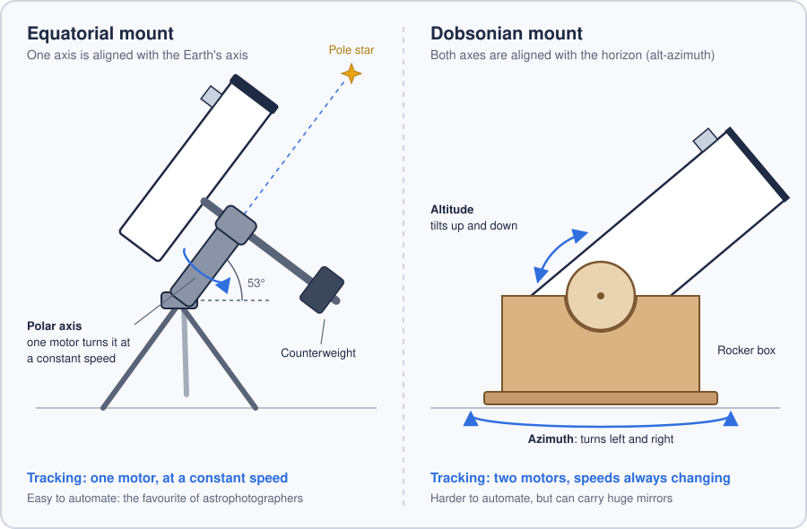
  <br>
  <sub><b>Figure 2.</b> An equatorial mount follows the sky with one axis; a Dobsonian needs to move two.</sub>
</p>

### 1.5 What "GoTo" means

An automated telescope has what is called a **GoTo** system. You choose an object on a handset or an app; motors in the mount then turn the telescope until it points straight at it. All that is left to do is look into the eyepiece.

The second half of the job is **tracking**, and it matters more than it sounds. The Earth spins at about 1,670 km/h at the equator, and still around 1,000 km/h here in Dublin, so the whole sky appears to turn by 15° every hour. That seems slow, but at high magnification the field of view is tiny: an object can drift right across the eyepiece in less than a minute. Without tracking, you spend the night nudging the tube. And when you want to show a planet to a friend, it has already slid out of view by the time they put their eye to the eyepiece.

A GoTo system takes the rotation of the Earth into account and keeps moving the telescope so that the object stays centred, for as long as you want to look at it.

### 1.6 Without GoTo: the art of star hopping

On a manual telescope, you aim by hand. For a bright star or a planet, this is easy: you can see them with the naked eye and simply line the telescope up with them. But most nebulae and galaxies are invisible to the naked eye, so you cannot aim at them directly.

The classic technique is **star hopping**. You start from a bright star you can see, then "hop" from star to star with the help of a sky chart, following a trail of recognisable patterns, until the target finally appears in the eyepiece.

It works, but it has real limits:

- It can be slow and tedious.
- It requires a sky chart and a decent knowledge of the constellations around the target.
- It depends heavily on how close the object is to bright, well-known stars. Some targets are easy to find; others sit in empty patches of sky and can take a long time to locate.

Some purists love this hunt: for them, it is part of the pleasure. Not for me. I want to spend my nights looking *at* objects, not looking *for* them.

### 1.7 My telescope, and why I built DobsonGo

For visual observation, I love Newtonian telescopes on Dobsonian mounts. But I also wanted a GoTo system, and that is where things got complicated. GoTo systems are expensive, and they are rarely sold with Dobsonian mounts.

On top of that, my telescope is a **truss-tube** Dobsonian. Instead of a solid tube, it uses metal poles that connect a mirror box at the bottom to an upper cage at the top, which holds the secondary mirror and the eyepiece. A black cloth shroud is pulled over the poles to keep out stray light. Optically, it works exactly like a solid tube. The difference is that the poles come apart completely. A classic Dobsonian is a large solid tube, sometimes more than 1.2 m tall, which is cumbersome to store and hard to move. A truss Dobsonian packs down into a few parts that fit in a car.

<p align="center">
  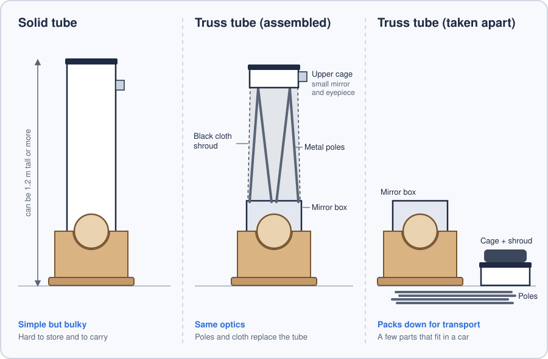
  <br>
  <sub><b>Figure 3.</b> The same optics in a solid tube and in a truss tube that comes apart for transport.</sub>
</p>

> **Another note on words.** In French, truss telescopes are called *"télescopes serrurier"*, after Mark Serrurier, the American engineer who in 1935 designed the truss of the famous 5-metre Hale Telescope at Mount Palomar. Strictly speaking, amateur trusses are a simpler design than his, but the name has stuck in France.

I could not find a Newtonian telescope on a Dobsonian mount that combined a truss tube, a built-in GoTo system and an affordable price. So I decided to build the GoTo system myself: fit motors to the mount, and develop an Android app able to compute, very precisely, where any object in the sky is at any given moment, and keep the telescope pointed at it.

And why stop at stars and galaxies? Some targets move much faster: artificial satellites. The International Space Station orbits about 400 km above our heads at roughly 28,000 km/h. When it passes overhead, it crosses the sky at about one degree per second, twice the width of the full Moon every single second. Following it through an eyepiece by hand is almost impossible. With a precise enough tracking system, it becomes possible. That is the long-term ambition of DobsonGo: one day, to follow the ISS through my own telescope.

<p align="right"><a href="#top">Back to top ⬆️</a></p>

---

<a id="part-2"></a>

## 🛠️ Part 2: The DobsonGo project

> *How DobsonGo works: the hardware fitted to the telescope and the software that controls it.*

| Component | Choice |
|---|---|
| **Telescope** | Newtonian reflector, truss tube, Dobsonian mount |
| **Motors** | 2 × NEMA 23 stepper motors (1.2 N·m), with reduction gearing |
| **Position sensing** | 2 × 18-bit magnetic encoders (SPI) |
| **Controller** | ESP32, programmed with the Arduino framework |
| **Wireless link** | Bluetooth Low Energy |
| **App** | Android |

### 2.1 The hardware

#### Two motors, two axes

The GoTo system requires two motors, one for each movement of the Dobsonian mount:

- one rotates the telescope left and right: the **azimuth** (Az);
- the other tilts it up and down: the **altitude** (Alt).

The project uses **NEMA 23 stepper motors**. NEMA 23 is a standard motor size, with a faceplate of approximately 57 mm. Unlike a conventional motor, a stepper motor does not rotate continuously: it moves in small, precise increments called **steps**, and holds its position firmly when stationary. Each motor is controlled by a **driver**, a power board that receives step commands from the microcontroller and supplies the appropriate current to the motor's coils.

Each motor delivers a torque of 1.2 N·m. **Reduction gearing** will be installed between each motor and its axis. It reduces the speed, multiplies the torque and improves precision: the motor completes many revolutions for each revolution of the telescope. With this gearing, the motors are expected to provide enough torque to move the mount, at a speed sufficient to track fast-moving objects such as the ISS.

#### Determining where the telescope is pointing

A GoTo system must know the altitude and azimuth of the telescope at all times. Two methods are possible.

**Option 1: counting steps.** Since a stepper motor moves in fixed steps, the controller can count the steps it sends and convert them into an angle. A standard NEMA 23 motor moves 1.8° per step, which gives 200 steps per revolution of the shaft, and the driver can divide each step into smaller *microsteps*. Because of the reduction gearing, one revolution of the motor corresponds to only a fraction of a revolution of the telescope. With a reduction ratio R:

```
steps per degree = (200 × microsteps × R) / 360
```

For example, with 16 microsteps and a 100:1 reduction ratio: 200 × 16 × 100 / 360 ≈ 889 microsteps per degree, so a single microstep moves the telescope by approximately 4 arcseconds.

However, this method relies entirely on the motor executing every step correctly. A stepper motor operates in "open loop": it does not report its actual position. If it meets a resistance greater than its torque (a caught cable, a stiff bearing, a gust of wind on the tube), it can **skip a step**: the controller records a step, but the shaft has not moved. Each skipped step introduces a small error, and these errors accumulate over time. Eventually, the controller may consider the telescope to be at 50° of altitude while it is actually at 45°.

**Option 2: magnetic encoders (the method used in this project).** Instead of estimating the position of the telescope, this method measures it directly. A magnetic encoder consists of a small sensor board and a magnet. The magnet is fixed to the end of the axis and rotates with the telescope; the sensor is fixed, facing the magnet at a distance of a few millimetres (5 mm maximum for the sensors used here). It measures the direction of the magnetic field and converts it into an angle between 0 and 360°, which it transmits to the microcontroller over SPI, a high-speed wired interface between chips. One encoder is fitted on each axis.

This method has two main advantages:

- **It measures the actual position.** The encoders have a resolution of 18 bits: they divide a full revolution into 262,144 positions, which allows them to detect changes of approximately 0.0014°, or 5 arcseconds (1/360 of the apparent diameter of the full Moon). Resolution should not be confused with accuracy: the actual precision also depends on the centring of the magnet and on calibration. Unlike step counting, however, the error does not increase over time.
- **It is absolute.** The encoder reads the actual angle at any moment. If the automatic mode is switched off and the telescope is moved by hand, the system still knows its exact position when the automatic mode is switched back on.

<p align="center">
  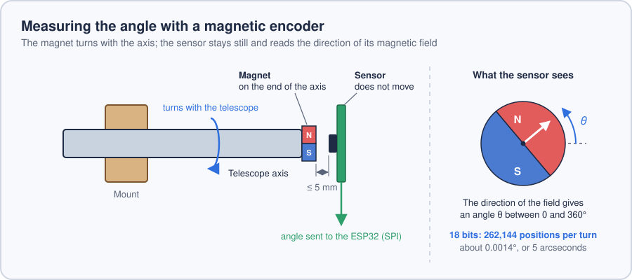
  <br>
  <sub><b>Figure 4.</b> The magnet rotates with the axis, and the fixed sensor converts the direction of its field into an angle.</sub>
</p>

### 2.2 The software

<p align="center">
  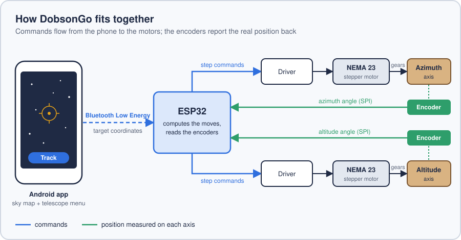
  <br>
  <sub><b>Figure 5.</b> Overview of the system, from the phone to the motors and back.</sub>
</p>

#### A phone instead of a hand controller

Once the main mechanical design was defined, the next step was to determine how the positions of celestial objects would be sent to the telescope. Standard GoTo mounts use a wired hand controller: a small keypad for entering catalogue numbers and selecting objects from a menu. Since smartphones and Bluetooth make this unnecessary, the telescope is controlled wirelessly from a phone app instead.

#### On the telescope: an ESP32

On the telescope, a microcontroller would receive the commands and the coordinates of the target, calculate the number of steps each motor must perform, and control the motors. The project uses an **ESP32**, a low-cost microcontroller with built-in Wi-Fi and Bluetooth, which can be programmed with the Arduino framework. Wi-Fi is not used in this project, but the ESP32 remains a very affordable option.

#### Bluetooth Classic or Bluetooth Low Energy?

The term "Bluetooth" covers two different technologies:

- **Bluetooth Classic** is used, for example, by wireless headphones. It maintains a continuous connection to transmit a constant stream of data, such as audio, and consumes more power.
- **Bluetooth Low Energy (BLE)**, introduced with Bluetooth 4.0 in 2010, is designed to exchange short messages only when required, with very low power consumption. A BLE device exposes a set of named values called *characteristics*: the phone can write to them (for example, to send target coordinates) or subscribe to notifications when they change (for example, to receive the current position).

A telescope controller does not transmit audio: it exchanges small, regular messages such as coordinates, commands and positions. BLE is designed precisely for this type of communication, which is why it was chosen for this project. It is supported by the ESP32 and by almost all modern phones. In addition, a phone can use both technologies at the same time: I could listen to music on wireless headphones while the telescope would track the sky!

#### The app: building from scratch or adapting an existing one

Since the phone used for this project runs on Android, it was decided that the application would be developed for this platform. Two possible approaches were, however, considered.

The first was to develop an app from scratch: draw a map of the sky, allow the user to navigate it, tap a star or a galaxy, and track it in real time. This would have required a considerable amount of work, and the result would have never looked as good as the polished stargazing apps already on the market.

The second was to take an existing stargazing app and add a menu to it for controlling the telescope over BLE. This second approach was chosen for its simplicity. The app I had found already computed the positions of celestial objects in real time. The remaining task was to retrieve these coordinates and send them to the ESP32 over BLE, which then controls the motors.

On paper, this approach was straightforward. It also removes the need to build a dedicated database of celestial coordinates, since the app's own data can be used. This saves a considerable amount of time: there are tens of thousands of objects to observe in the sky, and their data is maintained by many different organisations depending on the type of object, for example the European Space Agency's Gaia mission for star positions, NASA's Jet Propulsion Laboratory for planets and comets, and historical catalogues such as the New General Catalogue for nebulae and galaxies.

### 2.3 Securing the connection
 
Communication between the Android app and the ESP32 is protected by a simple challenge–response scheme, so that only an authorised phone can control the telescope.
 
A shared secret key is stored on both sides: hard-coded in the ESP32 firmware, and entered once by the user in the app on first launch. The key itself is never transmitted over the air.
 
At startup, the phone scans for nearby BLE devices. When the user selects the telescope, the following exchange takes place:
 
1. The ESP32 publishes a random **challenge** on a dedicated authentication characteristic. A new challenge is generated every five minutes.
2. The phone reads the current challenge.
3. The phone computes a **response** from the challenge and the shared key, using **HMAC-SHA256**. This function takes two inputs, a key and a message, and returns a fixed-size fingerprint. The same message produces a completely different result if the key differs:
```
   HMAC-SHA256(key = "correct-key", message = "1a2b3c…") = e4f9…c7
   HMAC-SHA256(key = "wrong-key",   message = "1a2b3c…") = 20b8…5d
```
   The two keys give completely different results for the same message. *(illustrative, truncated values)*
 
4. The phone sends its response to the ESP32.
5. The ESP32 has computed the same HMAC-SHA256 on its side, from the same challenge and its own copy of the key, and compares the two.
6. If they match, the phone has proved that it holds the same key without ever transmitting it, and the connection is granted. Otherwise, it is refused.
Because the challenge is random and renewed every five minutes, a response captured by a third party is only valid for a short time, which limits the window during which it could be replayed.
 
<p align="center">
  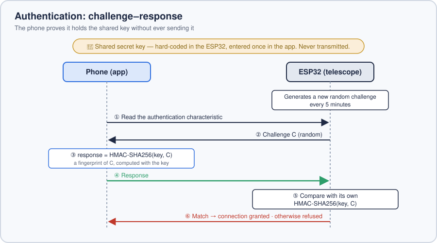
  <br>
  <sub><b>Figure 6.</b> The challenge–response exchange that authorises a phone to control the telescope.</sub>
</p>

### 2.4 Reading data from the app
 
Once the decision was made to add a menu to an existing app, the next step was to determine how the menu could obtain data from that app. The principle is straightforward: when the user selects an object (for example Jupiter), the menu needs the app to provide that object's celestial coordinates.
 
The difficulty lies in how the stargazing app I have chosen is built. It is a Unity application compiled with the **IL2CPP** backend. In simple terms, Unity offers two scripting backends:
 
- **Mono**: the C# code is compiled to .NET intermediate language (IL) and executed by a managed virtual machine at runtime. The managed metadata makes it relatively straightforward to inspect objects and call their methods.
- **IL2CPP**: Unity converts the IL to C++ ahead of time, then compiles it to native machine code packaged in shared libraries (`.so` files). There is no managed virtual machine; the original structure is much harder to recover, and everything happens at the native level.
With IL2CPP, these `.so` libraries are loaded into the app's memory at runtime from the app's Java code (via `System.loadLibrary`), and they compute the coordinates of celestial objects directly in memory. Reading those values therefore has to be done at the native level.
 
To achieve this, the project adds its [own C++ library](android/app/src/main/cpp), compiled into a `.so` file and loaded into the app. It uses [**ShadowHook**](https://github.com/bytedance/android-inline-hook), an open-source hooking framework developed by ByteDance. ShadowHook performs *inline hooking*: it rewrites the first instructions of a target function in memory so that execution is redirected to custom code, while a trampoline preserves the original function. (The other common technique, PLT/GOT hooking, only intercepts calls made between libraries through the symbol table; inline hooking can also reach functions internal to a library.)
 
With this mechanism, the library intercepts the relevant function call, obtains the in-memory instance of the selected object (for example Jupiter), and calls the methods that return its celestial coordinates. The coordinates are then passed to the app's Java layer through **JNI** (Java Native Interface), the standard bridge between native C/C++ code and Java. The Java side performs a few calculations before sending the result to the ESP32 over BLE.
 
<p align="center">
  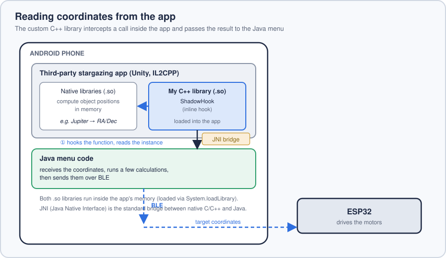
  <br>
  <sub><b>Figure 7.</b> How the coordinates travel from the app to the Java menu, and on to the ESP32.</sub>
</p>

### 2.5 The floating control menu
 
The control menu is a round, floating button displayed on top of the stargazing app, as an overlay view. The user can drag it to different positions on the screen, and tapping it opens the menu.
 
The menu itself is rendered in a **WebView** and written entirely in HTML, which allows far more styling freedom than Android's standard XML layouts. The full HTML code for the WebView is located in the [assets folder](android/app/src/main/assets/telescope_menu.html). User actions in the WebView are handled in **JavaScript**, which passes information back to Java through a **JavaScript interface** object, a bridge that lets the web page call Java methods.
 
For example, when the user selects Jupiter in the app, the planet appears in the HTML menu with a "Track" button. Tapping that button calls a JavaScript function, which in turn triggers the JavaScript interface: the Java code then knows that the user requested tracking, and sends the coordinates obtained at the previous step to the ESP32 over BLE.
 
<p align="center">
  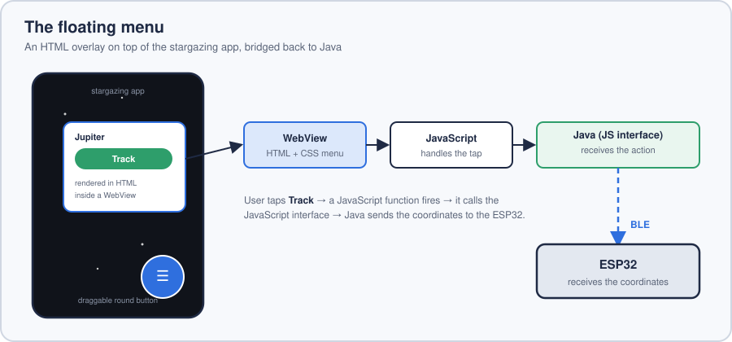
  <br>
  <sub><b>Figure 8.</b> The floating menu: an HTML overlay bridged back to Java through a JavaScript interface.</sub>
</p>

<p align="right"><a href="#top">Back to top ⬆️</a></p>

<a id="part-3"></a>

## 🌌 Part 3: Computing the position of celestial objects

> *To track an object, the telescope must know where it is at every moment. This part explains how positions in the sky are described, and how DobsonGo calculates them for each type of object.*

### 3.1 Celestial coordinates

There are two main ways of describing where an object is in the sky (Figure 6).

**Horizontal coordinates (Alt/Az)** describe the object as the observer sees it. The **altitude** is its height above the horizon, from 0° on the horizon to 90° straight overhead. The **azimuth** is its direction, as on a compass: 0° for north, 90° for east, 180° for south and 270° for west. These are the two movements of a Dobsonian mount, so they are the values the motors need. However, they depend on where the observer stands and change constantly as the Earth rotates, so they cannot be written in a catalogue.

**Equatorial coordinates (RA/Dec)** work like a map of the sky. The **declination** is the equivalent of a latitude: the angle north or south of the celestial equator, which is the projection of the Earth's equator onto the sky. The **right ascension** is the equivalent of a longitude: it is measured along the celestial equator from a reference point called the *March equinox point*, and is usually expressed in hours, one hour being equal to 15°. Because this grid is attached to the stars and not to the observer, the RA/Dec of a star are the same for everyone and do not change as the Earth rotates. This is why catalogues use them. To point the telescope, DobsonGo therefore converts RA/Dec into Alt/Az, which requires the latitude and longitude of the observer and the exact time.

<p align="center">
  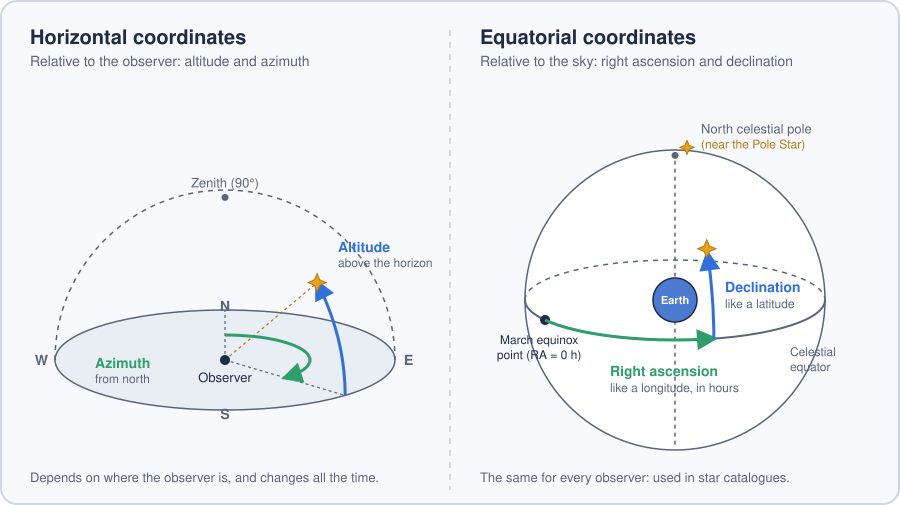
  <br>
  <sub><b>Figure 6.</b> Horizontal coordinates are attached to the observer; equatorial coordinates are attached to the sky.</sub>
</p>

<details>
<summary><b>How are RA/Dec converted into Alt/Az?</b></summary>
<br>

> 1. **Sidereal time.** The stars come back to the same place in the sky every 23 hours and 56 minutes, a period called a *sidereal day*, which is about four minutes shorter than a solar day. From the date, the time and the longitude of the observer, we calculate the *local sidereal time*: the right ascension that is crossing the meridian, due south, at that moment.
> 2. **Hour angle.** Subtracting the right ascension of the object from the local sidereal time gives its *hour angle*, which tells how far the object is from the meridian.
> 3. **Spherical trigonometry.** The hour angle, the declination of the object and the latitude of the observer are combined to obtain the altitude and the azimuth.

</details>

### 3.2 Orekit on Android

Converting coordinates precisely means dealing with many details: time scales that differ by several seconds, the slow movements of the Earth's axis, the small irregularities of its rotation. Rather than implementing all of them, DobsonGo relies on **[Orekit](https://www.orekit.org/)**, an open-source Java library for space flight dynamics, used in the space industry to calculate orbits. Orekit is written entirely in Java, so it runs on Android like any other library. It is built on **[Hipparchus](https://hipparchus.org/)**, a mathematics library.

#### 3.2.1 Adding the library

Orekit and Hipparchus are published on Maven Central, so they are added to the Android project as ordinary Gradle dependencies. Their versions are declared in the version catalog [`libs.versions.toml`](android/gradle/libs.versions.toml#L9-L10), and the libraries are imported in [`build.gradle`](android/app/build.gradle#L70-L77): Orekit 13.1.3, together with seven modules of Hipparchus 4.0.2.

#### 3.2.2 Embedding the data

The library alone is not enough. Orekit also needs **physical data**, measured and published by scientific organisations, which cannot be calculated in advance. DobsonGo embeds the official `orekit-data` archive, about 20 MB, in the resources of the app, as [`orekit_data.zip`](android/app/src/main/res/raw/orekit_data.zip). Its main files are:

| Data | Content | Used for |
|---|---|---|
| `tai-utc.dat` | history of the offset between UTC and atomic time, including every leap second | converting the time of the phone (UTC) into the time scales used for calculations |
| `Earth-Orientation-Parameters/` | measurements of the Earth's rotation and of the movements of its pole, published by the IERS | precise reference frames, such as TOD |
| `DE-440-ephemerides/` | JPL planetary ephemerides | positions of the Sun, the Moon and the planets |
| `Potential/`, `MSAFE/`, `CSSI-Space-Weather-Data/`, `fes2004_Cnm-Snm.dat` | gravity field of the Earth, solar and geomagnetic activity, ocean tides | precise propagation of satellite orbits |

Orekit reads its data from files or zip archives stored on disk. On Android, however, the resources of an app are packed inside its APK and have no file path. The function [`OreKitInstaller()`](android/app/src/main/java/com/terroroo/dobsongomenu/RealAstronomy.java#L729) therefore works in two steps:

1. at the first launch, it copies the archive, unchanged, from the resources to the internal storage of the app (`/data/user/0/<package>/files/`);
2. at each launch, it registers this copy as a data source of Orekit, with a `ZipJarCrawler`, which reads the files directly inside the archive without extracting them ([lines 754–755](android/app/src/main/java/com/terroroo/dobsongomenu/RealAstronomy.java#L754-L755)):

```java
DataProvidersManager manager = DataContext.getDefault().getDataProvidersManager();
manager.addProvider(new ZipJarCrawler(out_orekitZip));
```

`OreKitInstaller()` is called when the mod starts, in [`DobsonGoMod.init()`](android/app/src/main/java/com/terroroo/dobsongomenu/DobsonGoMod.java#L261), before any calculation; if it fails, the app is closed with an error message. Orekit then opens each file only when it first needs it.

#### 3.2.3 Using Orekit

In DobsonGo, Orekit converts the J2000 positions of static objects into positions of the current date, in the function [`dso_j2000toOfDate()`](android/app/src/main/java/com/terroroo/dobsongomenu/RealAstronomy.java#L690); [3.3.1](#331-static-objects) explains why this correction is needed. Three notions of Orekit are involved:

- **`AbsoluteDate`** represents an instant, independently of any time scale. `new AbsoluteDate(new Date(), TimeScalesFactory.getUTC())` reads the clock of the phone, which is expressed in UTC; Orekit uses the leap seconds to place this instant precisely on its own time scale.
- **`Frame`** represents a reference frame, that is, a set of axes in which positions are expressed. `FramesFactory.getEME2000()` is the frame of the J2000 catalogues, attached to the mean equator and equinox of 1 January 2000. `FramesFactory.getTOD(false)` is the frame of the true equator and equinox of the current date (*True Of Date*).
- **`Transform`** represents the change from one frame to another. `getTransformTo()` calculates it for a given date, including precession, nutation and the corrections measured by the IERS, and `transformVector()` applies it to a direction.

The RA/Dec of the object are first turned into a direction vector, which is transformed from one frame to the other ([lines 703–707](android/app/src/main/java/com/terroroo/dobsongomenu/RealAstronomy.java#L703-L707)), then turned back into RA/Dec:

```java
Frame eme2000 = FramesFactory.getEME2000();
Frame trueOfDate = FramesFactory.getTOD(false);

Transform t = eme2000.getTransformTo(trueOfDate, now);
Vector3D vDate = t.transformVector(vJ2000);
```

Orekit also provides the models needed for the other categories of objects, such as SGP4 for satellite TLEs and Keplerian orbits for the bodies of the Solar System.

### 3.3 Three types of objects

The RA/Dec of an object are not always fixed: some objects move across the sky on their own, sometimes very quickly. In DobsonGo, each object of the app has a type, defined in the enum [`SkyObjectType`](android/app/src/main/java/com/terroroo/dobsongomenu/RealAstronomy.java#L50). The types are grouped into three categories, each with its own class and its own way of obtaining RA/Dec:

| Category | Class | Types of objects | Source of the RA/Dec |
|---|---|---|---|
| **Static objects** | [`StaticObject`](android/app/src/main/java/com/terroroo/dobsongomenu/RealAstronomy.java#L326) | stars, constellations, deep-sky objects, meteor showers | J2000 catalogue, corrected to the current date |
| **Artificial satellites** | [`Satellite`](android/app/src/main/java/com/terroroo/dobsongomenu/RealAstronomy.java#L432) | satellites, including the ISS | two-line element sets (TLE) |
| **Orbital objects** | [`OrbitalObject`](android/app/src/main/java/com/terroroo/dobsongomenu/RealAstronomy.java#L368) | Moon, planets, dwarf planets, asteroids, comets, objects searched in Horizons | Keplerian elements from JPL Horizons |

<p align="center">
  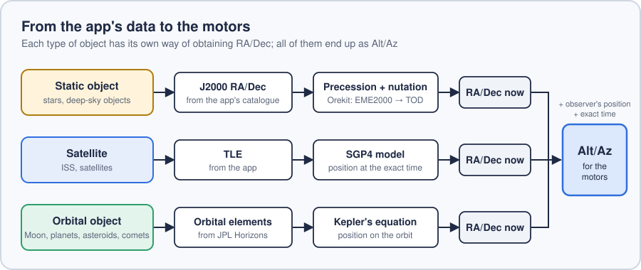
  <br>
  <sub><b>Figure 7.</b> Each category has its own way of obtaining RA/Dec, which are then all converted into Alt/Az.</sub>
</p>

#### 3.3.1 Static objects

Static objects are located outside the Solar System: stars, and deep-sky objects (DSOs) such as galaxies and nebulae, from a few light-years to millions of light-years away. These objects do move through space, but they are so far away that their movement is invisible on the scale of a human life: even Barnard's Star, the star that moves the fastest across our sky, shifts by only about 10 arcseconds per year. Their RA/Dec can therefore be treated as fixed.

Catalogue positions are given for a reference date called an *epoch*. The standard epoch is **J2000.0**, which corresponds to 1 January 2000 at 12:00. The app gives the J2000 positions of its objects, and a `StaticObject` stores them in its `RA_j2000` and `DEC_j2000` fields.

<details>
<summary><b>What is a Julian Date?</b></summary>
<br>

> Astronomers often express dates as a **Julian Date** (JD): a simple count of the days that have passed since noon on 1 January 4713 BC. Counting in days avoids the complications of the calendar, such as months of different lengths, leap years and time zones, and makes it easy to calculate the time between two events. The J2000.0 epoch corresponds to the Julian Date 2451545.0. Despite its name, the Julian Date has nothing to do with the Julian calendar.

</details>

**Precession and nutation.** The J2000 positions are no longer exact today. This is not because the stars have moved, but because the Earth's axis has. The Sun and the Moon pull on the bulge of the Earth at the equator, which makes its axis slowly wobble like a spinning top and trace a circle in the sky in about 26,000 years: this is **precession** (Figure 8). A much smaller oscillation, **nutation**, caused mainly by the Moon, makes the axis "nod" by up to about 17 arcseconds over a period of 18.6 years.

RA/Dec are measured from the celestial equator and the March equinox point, which both depend on the orientation of the Earth's axis, so these two phenomena shift the whole coordinate grid. Since 2000, precession alone has moved positions by about 0.36°, which is more than the field of view of an eyepiece at high magnification.

<p align="center">
  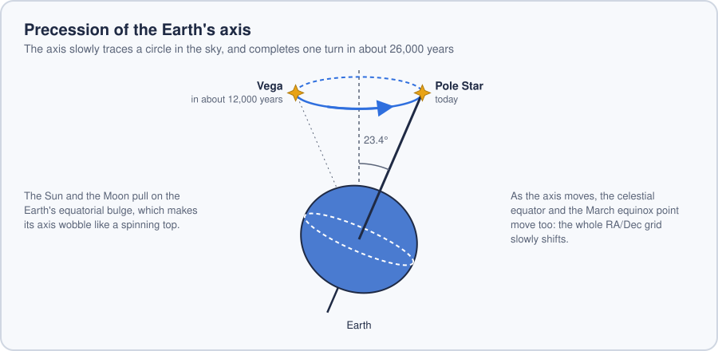
  <br>
  <sub><b>Figure 8.</b> Precession: the Earth's axis slowly traces a circle in the sky.</sub>
</p>

The stargazing app draws objects at their J2000 positions. This is not a problem on a phone screen, where a difference of a few pixels goes unnoticed, but a GoTo system needs more precision. The function [`dso_j2000toOfDate()`](android/app/src/main/java/com/terroroo/dobsongomenu/RealAstronomy.java#L690) therefore converts these positions to the current date with Orekit, as described in [3.2.3](#323-using-orekit).

#### 3.3.2 Artificial satellites

Satellites move much faster than any other object. The ISS orbits the Earth in about 90 minutes, at around 28,000 km/h, and crosses the whole sky in a few minutes, so its RA/Dec change every second. It is also only about 400 km above the ground: two observers a few hundred kilometres apart see it in very different directions at the same moment. Its position must therefore be calculated for the exact time and the exact place of the observation.

The orbits of satellites are shared in a standard text format called the **two-line element set** (TLE). This format comes from orbit models adopted by NORAD, the North American Aerospace Defense Command, in the early 1970s, and TLEs are now published by the United States Space Force. Here is the TLE of the ISS on 20 September 2008, the example used on [Wikipedia](https://en.wikipedia.org/wiki/Two-line_element_set):

```
ISS (ZARYA)
1 25544U 98067A   08264.51782528 -.00002182  00000-0 -11606-4 0  2927
2 25544  51.6416 247.4627 0006703 130.5360 325.0288 15.72125391563537
```

Each group of characters, at a fixed position in the line, gives one piece of information about the orbit (Figure 9). For example, the inclination of 51.64° means that the ISS never flies over places further north or south than 51.6° of latitude, so it never passes exactly overhead for observers beyond that latitude.

<p align="center">
  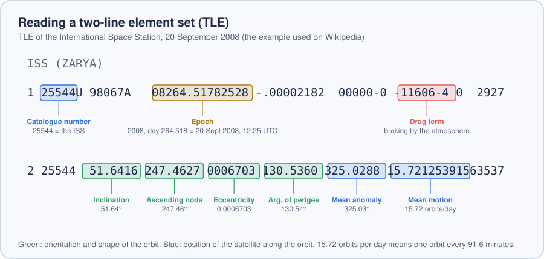
  <br>
  <sub><b>Figure 9.</b> How to read the TLE of the ISS.</sub>
</p>

A TLE is designed to be used with a calculation model called **SGP4**, which gives the position of the satellite at any moment, taking into account effects such as the flattening of the Earth and the braking of the atmosphere. The stargazing app already contains the TLEs of most satellites: DobsonGo's native C++ library retrieves them, and a `Satellite` object stores them in its `Tle1` and `Tle2` fields, together with the NORAD catalogue number of the satellite (`noradId`).

#### 3.3.3 Orbital objects

Orbital objects travel around the Sun or around a planet: the Moon, the planets, dwarf planets, asteroids and comets. Their RA/Dec also change over time, more or less quickly: the Moon moves by about 13° per day against the background of the stars, while the distant planets take months to move by a few degrees. Their position is calculated from the shape of their orbit.

At the beginning of the 17th century, the German astronomer Johannes Kepler showed, using Tycho Brahe's observations of Mars, that planets move along ellipses with the Sun at one focus, and faster when they are closer to the Sun. An orbit can therefore be described by six numbers, the **Keplerian elements**, valid at a given date called the epoch: two describe the size and shape of the ellipse, three its orientation in space, and the last one the position of the object along it (Figure 10). Each element is described in detail in the documentation of the [`KeplerianSnapshot`](android/app/src/main/java/com/terroroo/dobsongomenu/RealAstronomy.java#L120-L188) class. From these elements, the position of the object at any other moment is obtained by solving *Kepler's equation*.

<p align="center">
  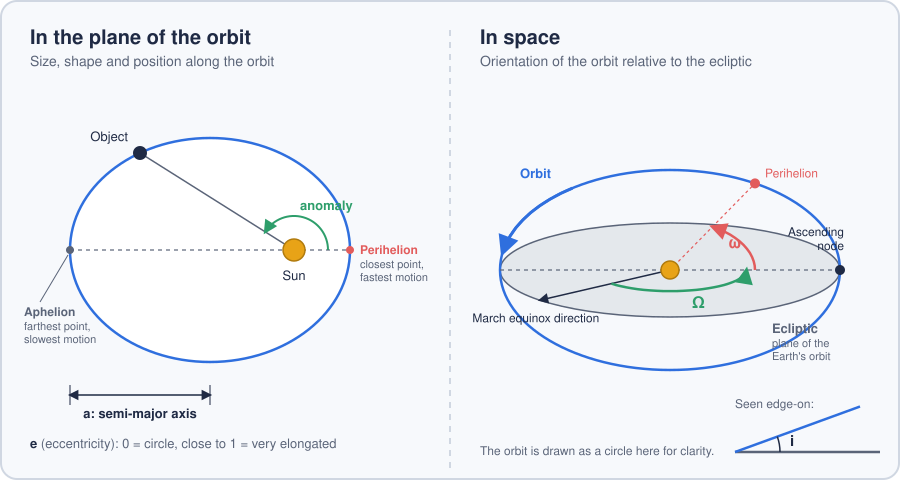
  <br>
  <sub><b>Figure 10.</b> The Keplerian elements: size and shape of the orbit (a, e), position along it (anomaly), and orientation in space (i, Ω, ω).</sub>
</p>

**The many-body problem.** Keplerian elements assume that only two bodies are involved, for example an asteroid and the Sun. In this *two-body problem*, the orbit never changes. In the Solar System, however, all bodies attract one another. When an asteroid or a comet passes near a planet, and especially near Jupiter, its orbit is slightly modified; comets are also pushed by the gas they release near the Sun. Keplerian elements therefore remain accurate only for a limited time around their epoch: elements dated 2015 and used today can give a position quite far from the real one (Figure 11).

<p align="center">
  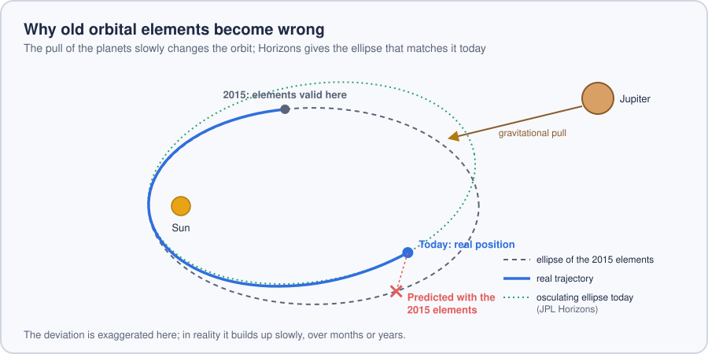
  <br>
  <sub><b>Figure 11.</b> Old Keplerian elements no longer match the real trajectory of the object.</sub>
</p>

This was a problem for DobsonGo, because the Keplerian elements stored in the stargazing app are out of date. Once again, the app can afford a few pixels of error, but the telescope cannot. The solution is to obtain up-to-date elements from JPL Horizons.

### 3.4 JPL Horizons

**JPL Horizons** is an online service of NASA's Jet Propulsion Laboratory (JPL) that calculates the positions of Solar System objects with very high precision. It was developed by the JPL engineer Jon Giorgini, has been available since October 1996, and covers the Sun, the planets and their moons, asteroids, comets and some spacecraft. Horizons does not rely on the two-body problem: for the planets and their moons, it uses JPL's planetary ephemerides (such as DE440 and DE441), and for asteroids and comets, it calculates their orbits step by step, adding the pull of the major bodies at each step.

Horizons can also give **osculating elements**. These are the Keplerian elements of the ellipse that matches the real motion of the object at a chosen instant, shown in green in Figure 11. Their name comes from the Latin *osculari*, "to kiss", because this ellipse "touches" the real trajectory at that instant. Calculated for a date close to the observation, they give an accurate position.

#### 3.4.1 Requesting the elements

The function [`fetchKElem()`](android/app/src/main/java/com/terroroo/dobsongomenu/HorizonsParser.java#L498) sends the following request to the Horizons API:

```
https://ssd.jpl.nasa.gov/api/horizons.api
  ?format=json
  &CENTER=500@10           elements relative to the centre of the Sun
  &EPHEM_TYPE=ELEMENTS     osculating orbital elements
  &COMMAND=<Horizons ID>   the object
  &START_TIME=<now>        from the current hour...
  &STOP_TIME=<now + 5 h>   ...to five hours later
  &STEP_SIZE=30m           one set of elements every 30 minutes
```

Horizons then returns a set of elements every 30 minutes, covering the next five hours of observation.

<details>
<summary><b>How does DobsonGo find the right object in Horizons?</b></summary>
<br>

> Horizons uses its own identifiers, which do not always match the names used in the app. The function [`parseId()`](android/app/src/main/java/com/terroroo/dobsongomenu/HorizonsParser.java#L318) translates the name of an object into a Horizons query. For example, the Moon becomes `301`, its identifier in Horizons, while asteroids, dwarf planets and comets are searched in the database of small bodies, which is indicated by a `;` at the end of the query. The names of asteroids and comets are first cleaned with regular expressions, to remove the catalogue numbers and parentheses that Horizons would not recognise.

> When a name is ambiguous, Horizons returns a list of candidates instead of the elements. In this case, `fetchKElem()` chooses the best candidate and sends a new request:

> - for planets and moons, it compares the names using the **Levenshtein distance**, which counts the number of characters to change to go from one name to the other, and ignores barycentres;
> - for asteroids and comets, it chooses the most recent orbit solution.

> The function [`fetchOrbitalObj()`](android/app/src/main/java/com/terroroo/dobsongomenu/HorizonsParser.java#L370) relies on the same mechanism to search the Horizons database directly from the menu.

</details>

#### 3.4.2 Reading the response

Horizons dates from the 1990s, and its output format shows it. Even through its API, available since 2021, the response is not structured data: the JSON only contains a `result` field holding the traditional text report of Horizons, which is designed to be read by a human. The function [`APIRequester()`](android/app/src/main/java/com/terroroo/dobsongomenu/HorizonsParser.java#L109) extracts this text. The useful data is located between two markers, `$$SOE` and `$$EOE` (*start* and *end of ephemeris*):

```
$$SOE
2461334.500000000 = A.D. 2026-Oct-21 00:00:00.0000 TDB
 EC= …  QR= …  IN= …
 OM= …  W = …  Tp= …
 N = …  MA= …  TA= …
 A = …  AD= …  PR= …
$$EOE
```

The first line gives the epoch of the elements, as a Julian Date and as a calendar date. Each label then corresponds to an orbital element: `EC` is the eccentricity, `IN` the inclination, `OM` the longitude of the ascending node, `W` the argument of perihelion, `MA` the mean anomaly and `A` the semi-major axis.

<p align="center">
  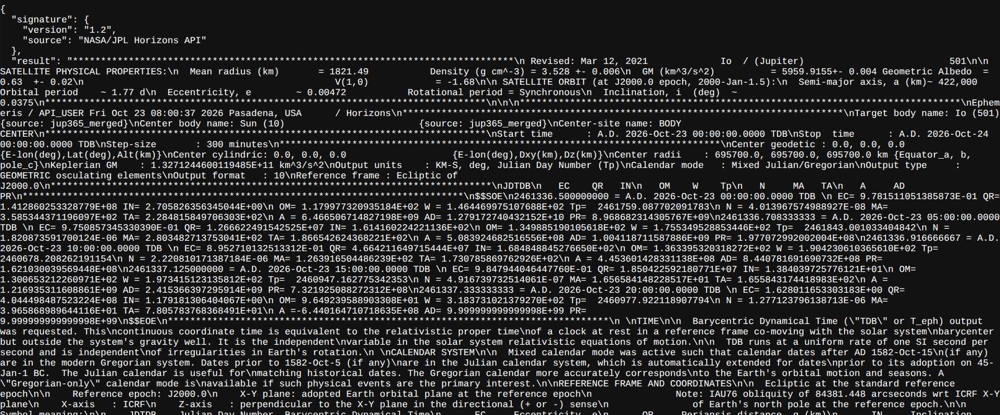
  <br>
  <sub><b>Figure 12.</b> Example of a response from the JPL Horizons API.</sub>
</p>

To read this text, `fetchKElem()` keeps only the part located between the two markers, then uses two regular expressions ([lines 587–588](android/app/src/main/java/com/terroroo/dobsongomenu/HorizonsParser.java#L587-L588)):

```java
// Line giving the epoch, for example "2461334.500000000 = A.D. 2026-Oct-21 ..."
Pattern jdPattern = Pattern.compile("^\\s*(\\d+\\.\\d+)\\s*=.*$");
// Each label followed by its value, including values in scientific notation
Pattern valuePattern = Pattern.compile("(EC|IN|OM|W|MA|A)\\s*=\\s*([-+]?\\d*\\.?\\d+(?:E[-+]?\\d+)?)");
```

The first expression detects the beginning of each set of elements, and the second reads the value of each element. The angles are then converted into radians, and each complete set becomes a `KeplerianSnapshot`, from which the RA/Dec of the object can be calculated as described in [3.3.3](#333-orbital-objects).

<p align="right"><a href="#top">Back to top ⬆️</a></p>

---

<p align="center"><i>If you have read this far, thank you for taking the time. I hope this project has given you a little inspiration. 🔭<br>Please note that this project is still in development and far from finished: I work on it in my free time, whenever I can.</i></p>
